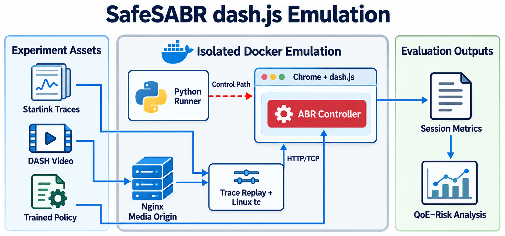
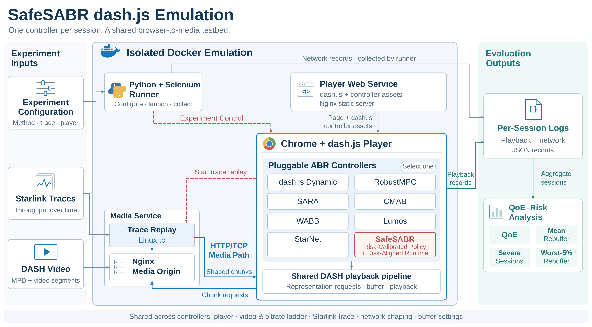

# SafeSABR dash.js Emulation

[](https://github.com/luopeng69131/SafeSABR)
[](LICENSE)

[中文说明](README_zh.md)

This repository provides the browser-based evaluation artifact for
**SafeSABR**, a risk-calibrated adaptive bitrate (ABR) framework for video
streaming over volatile Starlink links. It reproduces the paper's dash.js
experiment through a complete HTTP/TCP playback path comprising Chrome,
dash.js, Media Source Extensions, and an isolated Linux traffic shaper.

The repository provides the trained SafeSABR policy, its runtime risk model,
the evaluated ABR implementations, and the scripts for playback and analysis.
Obtain the Starlink measurements from [StarNet](https://github.com/ConnectedSystemsLab/StarNet#starnet-measurement-dataset)
and prepare the evaluation inputs locally.

## Emulation at a Glance



The experiment runs in isolated Docker networks. A Python runner controls the
Chrome-based dash.js player, while an Nginx media origin serves the DASH video
through a Linux traffic shaper driven by the selected Starlink trace. The
player exports session-level measurements for the common QoE and severe-risk
analysis.

## Reproduction Pipeline

### Requirements

- Linux with Docker Engine and Docker Compose v2
- Python 3.11 or newer
- At least 8 GB of free disk space for generated DASH media and containers
- At least 8 GB of memory for the default serial execution

No host-level traffic-control command is used. Network shaping runs inside an
isolated Docker container with a dedicated network namespace.

### 1. Prepare the Environment

```bash
bash scripts/prepare_runtime.sh
```

This command verifies the included artifacts, generates the six-representation
192-second DASH video, extracts exact chunk sizes, and builds the containers.

### 2. Run a Smoke Test

```bash
bash scripts/run_smoke.sh
```

The smoke test runs dash.js Dynamic and SafeSABR on a generated synthetic
network profile. It needs no StarNet data.

### 3. Run the Evaluation

Follow [Data Preparation](docs/DATASET.md) to obtain StarNet measurements and
prepare the local manifest, replay inputs, and any inputs required by the
selected baselines before running:

```bash
bash scripts/run_paper_experiment.sh
```

The default run evaluates all eight methods sequentially. To run selected
methods, use the public names below:

```bash
METHODS="robustmpc sara safesabr" bash scripts/run_paper_experiment.sh
```

Supported names are `dashjs`, `robustmpc`, `sara`, `cmab`, `wabb`, `lumos`,
`starnet`, and `safesabr`. Completed sessions are detected and skipped, so an
interrupted batch can be resumed with the same command.

On a machine with sufficient CPU and memory, parallel execution can be enabled
explicitly:

```bash
WORKERS=5 bash scripts/run_paper_experiment.sh
```

### 4. Analyze Local Runs

```bash
python3 -m pip install -r requirements-analysis.txt
bash scripts/analyze_results.sh
```

Tables and figures are generated from local runs in `results/paper/analysis`.

## Data, Models, and Methods

The evaluation uses measurements from the
[StarNet dataset](https://github.com/ConnectedSystemsLab/StarNet#starnet-measurement-dataset).
See [docs/DATASET.md](docs/DATASET.md) for the official source, local input
format, and session-selection procedure.

The exported SafeSABR policy and runtime risk model are included in
`app/assets/`. Verify the published models and pinned dash.js asset with:

```bash
python3 scripts/verify_artifact.py
```

All methods share the same browser, media, trace, network shaper, bitrate
ladder, and buffer configuration. The LEO-aware methods are adapted to the
common fixed-duration VOD action space where their original systems use a
different playback mode or additional controls. See
[docs/BASELINES.md](docs/BASELINES.md) for exact implementation boundaries and
source references.

## Emulation Details



Each session selects one pluggable ABR controller inside the shared dash.js
player. The runner, browser, player service, media origin, trace replay, and
evaluation path remain common across all methods.

## Acknowledgments

This artifact builds on [dash.js](https://github.com/Dash-Industry-Forum/dash.js)
and the [StarNet](https://github.com/ConnectedSystemsLab/StarNet) measurements.
We also thank the authors of
[comyco-lin](https://github.com/godka/comyco-lin),
[pensieve_retrain](https://github.com/GreenLv/pensieve_retrain), and the
[MMSys 2024 Starlink live-streaming artifact](https://github.com/clarkzjw/mmsys24-starlink-livestreaming)
for making their implementations available to the community.

## License

SafeSABR source code in this repository is released under the
[Apache License 2.0](LICENSE). Referenced third-party software and datasets
remain subject to their respective terms.
