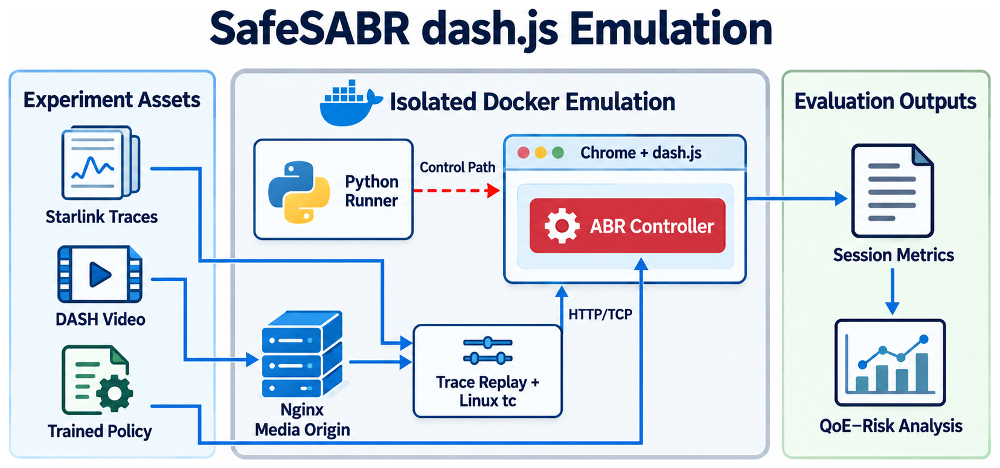
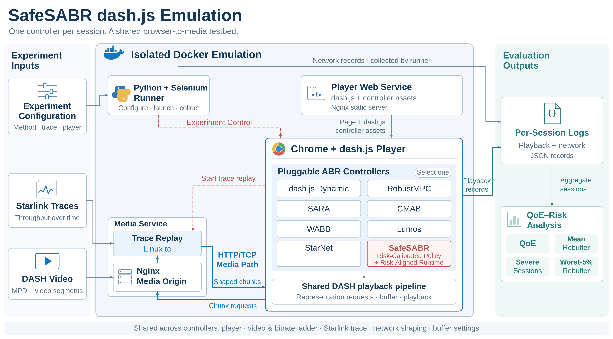

# SafeSABR dash.js 仿真实验

[](https://github.com/luopeng69131/SafeSABR)
[](LICENSE)

[English](README.md)

本仓库提供 **SafeSABR** 的浏览器端实验复现环境。SafeSABR 是一个面向高波动
Starlink 链路的风险校准自适应码率（ABR）框架。实验使用完整的 HTTP/TCP 播放链路，
包括 Chrome、dash.js、Media Source Extensions，以及运行在独立网络命名空间中的
Linux 流量整形器。

仓库提供训练完成的 SafeSABR 策略、运行时风险模型、ABR 对比方法及播放和分析脚本。
Starlink 测量数据请从 [StarNet 官方项目](https://github.com/ConnectedSystemsLab/StarNet#starnet-measurement-dataset)获取，并在本地准备评估输入。

## Emulation 概览



实验运行在相互隔离的 Docker 网络中。Python runner 控制基于 Chrome 的 dash.js
播放器，Nginx 视频源通过由 Starlink trace 驱动的 Linux 流量整形器传输 DASH 视频。
播放器记录 session 级测量结果，并由统一的分析流程计算 QoE 与严重风险指标。

## 复现流程

### 环境要求

- 安装 Docker Engine 和 Docker Compose v2 的 Linux 系统
- Python 3.11 或更高版本
- 至少 8 GB 可用磁盘空间，用于生成 DASH 视频和构建容器
- 默认串行执行建议至少 8 GB 内存

流量整形仅在独立 Docker 容器中进行，不会在宿主机网络接口上执行流量控制命令。

### 1. 准备环境

```bash
bash scripts/prepare_runtime.sh
```

该命令会校验仓库内的模型和依赖资源，生成包含六档表示的 192 秒 DASH 视频，
提取准确的 chunk 大小，并构建实验容器。

### 2. 运行 Smoke Test

```bash
bash scripts/run_smoke.sh
```

Smoke test 使用运行时生成的合成网络条件，分别运行 dash.js Dynamic 和 SafeSABR，无需 StarNet 数据。

### 3. 运行评估

先参照[数据准备说明](docs/DATASET.md)获取官方测量数据，在本地准备评估清单、回放输入及所选基线需要的输入：

```bash
bash scripts/run_paper_experiment.sh
```

默认依次运行全部八种方法。也可以通过公开方法名运行其中一部分：

```bash
METHODS="robustmpc sara safesabr" bash scripts/run_paper_experiment.sh
```

可用名称包括 `dashjs`、`robustmpc`、`sara`、`cmab`、`wabb`、`lumos`、
`starnet` 和 `safesabr`。脚本会自动跳过已经完成的 session，因此中断后可以使用
相同命令继续执行。

如果机器具有充足的 CPU 和内存资源，可以显式启用并发执行：

```bash
WORKERS=5 bash scripts/run_paper_experiment.sh
```

### 4. 分析本地实验结果

```bash
python3 -m pip install -r requirements-analysis.txt
bash scripts/analyze_results.sh
```

脚本根据本地实验生成图表，输出至 `results/paper/analysis`。

## 数据、模型与方法

实验使用 [StarNet 测量数据](https://github.com/ConnectedSystemsLab/StarNet#starnet-measurement-dataset)。
官方来源、本地输入格式和筛选过程详见[数据准备说明](docs/DATASET.md)。

导出的 SafeSABR 策略和运行时风险模型位于 `app/assets/`。可使用以下命令校验模型和
固定版本的 dash.js：

```bash
python3 scripts/verify_artifact.py
```

所有方法共享相同的浏览器、视频、trace、网络整形器、码率阶梯和缓存配置。对于原始
系统采用不同播放模式或包含额外控制变量的 LEO 方法，本仓库将其码率选择部分适配到
统一的固定时长 VOD 环境。具体实现边界和参考来源见
[docs/BASELINES.md](docs/BASELINES.md)。

## Emulation 细节



每个 session 在统一的 dash.js 播放器中选择一种可插拔 ABR controller。所有方法
共享相同的 runner、浏览器、播放器服务、视频源、trace 回放和结果分析路径。

## 致谢

本实验基于 [dash.js](https://github.com/Dash-Industry-Forum/dash.js) 和
[StarNet](https://github.com/ConnectedSystemsLab/StarNet) 测量数据构建。感谢
[comyco-lin](https://github.com/godka/comyco-lin)、
[pensieve_retrain](https://github.com/GreenLv/pensieve_retrain) 和
[MMSys 2024 Starlink 直播实验项目](https://github.com/clarkzjw/mmsys24-starlink-livestreaming)
的作者向社区公开实现。

## 许可证

本仓库中的 SafeSABR 源代码采用 [Apache License 2.0](LICENSE) 发布。引用的第三方
软件与数据集遵循各自的许可条款。
